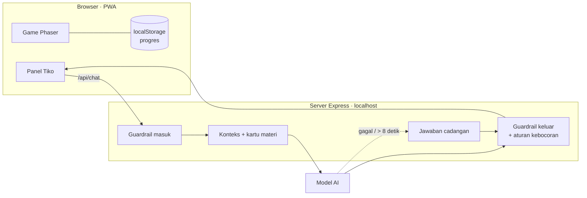

# Petualangan Pulau Tirta

Game eksplorasi 2D berbentuk PWA tempat siswa SD kelas V memulihkan pulau yang kekeringan dengan memperbaiki empat tahap siklus air, ditemani **Tiko**, tetes air AI yang menuntun dengan pertanyaan, bukan memberi jawaban.

Dibuat untuk LOGICODIX 2026, subtema Smart & Fun Education. Materi mengacu pada Buku Siswa IPAS Kelas V (Revisi), Bab 4 "Air Sumber Kehidupan".

## Menjalankan

Prasyarat: Node.js 20 atau lebih baru.

```bash
npm install
cp .env.example .env      # Windows: copy .env.example .env
npm start                 # build + server di http://localhost:3000
```

- Tanpa API key (atau `TIKO_MOCK=1`), Tiko memakai jawaban cadangan yang ditulis tim. Game tetap bisa dimainkan dari awal sampai tamat.
- Untuk memakai model AI, isi `ANTHROPIC_API_KEY` di `.env` dan ubah `TIKO_MOCK=0`.
- Setelah dibuka di Chrome atau Edge, game bisa diinstal sebagai aplikasi (ikon instal di address bar) dan dibuka tanpa internet.
- Mode demo: `http://localhost:3000/?demo=1&misi=misi-1` membuka misi langsung dan menampilkan sumber jawaban Tiko (AI / cadangan / template).

### Pengembangan

```bash
npm run dev        # Vite (5173) + server API (3000) dengan hot reload
npm test           # tes guardrail, aturan kebocoran, logika misi, Festival Hujan
npm run typecheck
```

## Struktur

```
content/        Konten: misi, pertanyaan alasan, petunjuk cadangan, kartu materi (JSON)
shared/         Logika tanpa UI yang dipakai game dan server: konten, guardrail, misi
server/         Server Express: file game + endpoint /api/chat untuk Tiko
src/            Game: Phaser (dunia), panel Tiko (HTML), dialog misi dan Festival Hujan
public/         Ikon PWA, peta Tiled (public/maps), aset
tests/          Tes Vitest
```

Konten dipisah dari kode: mengubah soal, pilihan alasan, atau petunjuk cukup lewat `content/*.json`, dan tes memastikan setiap petunjuk cadangan tetap lolos aturan kebocoran.

## Arsitektur



1. Pesan anak diperiksa dulu (panjang, data pribadi, kata kasar, cerita yang mengkhawatirkan). Yang tidak lolos dijawab template tanpa memanggil model.
2. Server menambahkan konteks game (lokasi, misi, alasan yang dipilih, tingkat petunjuk) dan hanya kartu materi yang relevan.
3. Jawaban model diperiksa lagi: kepantasan, panjang maksimal 3 kalimat, dan aturan kebocoran per misi dan per tingkat.
4. Kalau model gagal, lambat (lebih dari 8 detik), atau jawabannya tidak lolos, Tiko memakai jawaban cadangan.

## Desain prompt dan guardrail

- Tiko tidak pernah memberi jawaban pertanyaan misi. Petunjuk bertingkat: 1 pertanyaan balik, 2 menunjuk bukti di layar, 3 menjelaskan langkah.
- **Aturan kebocoran** (`shared/guardrail.ts`): di tingkat 1–2, kata jawaban (contoh "uap", "menguap") dilarang; di tingkat 3 konsep boleh disebut, tetapi kalimat yang mengutip atau terlalu mirip dengan pilihan benar ditolak. Pemeriksa yang sama berlaku untuk model dan jawaban cadangan.
- Fakta Tiko hanya dari `content/kartu-materi.json`.
- Sapaan proaktif dan "Aku harus ke mana?" memakai template, tanpa memanggil model.
- Siswa yang baru benar setelah petunjuk tingkat 3 dicatat "dibantu penuh".

## Privasi dan keamanan anak

Game ini dibuat untuk anak di bawah umur, sehingga:

- **Tanpa akun dan tanpa data pribadi.** Progres hanya disimpan di browser perangkat itu. Riwayat chat tidak disimpan di server dan hanya ada selama aplikasi dibuka.
- Tiko tidak menanyakan nama lengkap, alamat, sekolah, atau nomor HP. Kalau anak menuliskannya, pesan ditahan dan Tiko mengingatkan untuk tidak membagikannya.
- Pengguna selalu diberi tahu bahwa Tiko adalah AI (panel "Tentang Tiko").
- Kalau anak bercerita dirundung, disakiti, atau sangat sedih, Tiko menanggapi dengan lembut dan menyarankan bercerita ke guru atau orang tua.
- API key hanya di server (`.env`), tidak pernah dikirim ke browser atau di-commit.
- Pengembangan mengikuti UU No. 27 Tahun 2022 tentang Pelindungan Data Pribadi (Pasal 25, data pribadi anak) dan panduan penyedia model untuk produk yang dipakai anak di bawah 18 tahun.

## Aset dan lisensi

Sumber dan lisensi semua aset ada di [CREDITS.md](CREDITS.md). Lisensi kode: [ditentukan tim].

## Tim

Sabri (product lead: konten dan pitch) · Aufa (gameplay dan dunia) · Evan (misi dan UI) · Faza (AI dan backend)
