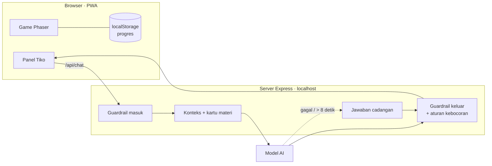

# Petualangan Pulau Tirta

Game eksplorasi 2D berbentuk PWA tempat siswa SD kelas V memulihkan pulau yang kekeringan dengan memperbaiki empat tahap siklus air, ditemani **Tiko**, tetes air AI yang menuntun dengan pertanyaan, bukan memberi jawaban.

Dibuat untuk LOGICODIX 2026, subtema Smart & Fun Education. Materi mengacu pada Buku Siswa IPAS Kelas V (Revisi), Bab 4 "Air Sumber Kehidupan".

## Menjalankan

Prasyarat: Node.js 20 atau lebih baru.

```bash
npm install
cp .env.example .env      # Windows: copy .env.example .env
npm start                 # build + server di http://localhost:3000
```

- Tanpa API key (atau `TIKO_MOCK=1`), Tiko memakai jawaban cadangan yang ditulis tim. Game tetap bisa dimainkan dari awal sampai tamat.
- Untuk memakai model AI, isi `GEMINI_API_KEY` di `.env` dan ubah `TIKO_MOCK=0`. Model bawaan `gemini-3.5-flash-lite`; bisa diganti lewat `TIKO_MODEL`. Server juga mendukung Anthropic (`TIKO_PROVIDER=anthropic` + `ANTHROPIC_API_KEY`). Cek `http://localhost:3000/api/health`: `"model": true` berarti Tiko memakai AI.
- Setelah dibuka di Chrome atau Edge, game bisa diinstal sebagai aplikasi (ikon instal di address bar) dan dibuka tanpa internet. Unduhan pertama sekitar 5 MB; peta arsip di `public/maps` tidak ikut disimpan.
- Tanpa internet, Tiko tetap menjawab: petunjuk bertingkat per misi, pertanyaan materi dari kartu materi, dan filter masuk yang sama dengan server.
- Mode demo: `http://localhost:3000/?demo=1` menampilkan sumber jawaban Tiko (AI / cadangan / template), melewati layar judul, dan tidak menyimpan progres. Tambahkan `&ke=pembuka`, `misi-1` … `misi-4`, `festival`, atau `tamat` untuk langsung lompat; tombol **Demo** di pojok kiri bawah (atau Ctrl+Shift+D) membuka panel lompat saat presentasi.
- Mode playtest: `http://localhost:3000/?playtest=1`. Anak bermain seperti biasa; pendamping membuka panel tersembunyi dengan **Ctrl+Shift+P** untuk mulai sesi anak berikutnya (kode Anak 1, Anak 2, …), mengisi skor tes sebelum dan sesudah, lalu menyalin atau mengunduh hasil sebagai CSV. Progres dan catatan playtest disimpan terpisah dari progres biasa, tanpa nama atau data pribadi.

### Pengembangan

```bash
npm run dev        # Vite (5173) + server API (3000) dengan hot reload
npm test           # tes guardrail, aturan kebocoran, logika misi, Festival Hujan
npm run typecheck
npm run uji:tiko   # uji kualitas Tiko: 30 soal materi, 50 prompt nakal, kebocoran tingkat 1–2
npm run uji:tiko -- --offline  # uji cadangan/template, tanpa kuota API
```

`npm run uji:tiko` memakai model kalau API key terisi dan `TIKO_MOCK` bukan `1`, lalu menulis laporan per jawaban ke `uji-hasil/`. Pengujian berjalan berurutan dengan jeda 4,5 detik antarpanggilan; atur `TIKO_UJI_JEDA_MS` sesuai kuota penyedia. Seluruh set bisa memerlukan beberapa menit dan hingga sekitar 100 panggilan. Tanpa key atau dengan `--offline`, semua pertanyaan tetap dinilai, tetapi hasilnya hanya membuktikan kualitas cadangan/template. Soal ada di `scripts/uji-tiko/`. Target PRD: materi ≥ 90% benar, prompt nakal 100% aman, 0 kebocoran.

Laporan memisahkan sumber model/cadangan/template. Saat API gagal, dijeda, tidak menghasilkan jawaban model, atau melewati batas waktu, uji online berstatus **BELUM TERVERIFIKASI** dan keluar dengan kode gagal meskipun semua jawaban cadangan benar. Jangan memakai skor offline sebagai bukti kualitas model langsung. Pemeriksaan kata kunci tetap perlu ditinjau manual.

## Cara bermain

| Tombol | Fungsi |
| --- | --- |
| WASD / panah | Berjalan |
| E atau Enter | Bicara dengan warga, membuka misi |
| E, Enter, atau Spasi | Melanjutkan dialog |
| Spasi | Lompat |
| T | Tanya Tiko (atau klik ikon Tiko di kiri bawah) |
| J | Jurnal Petualangan: status keempat tempat, satu kalimat petunjuk, Kartu Ilmu |
| Esc | Menu jeda: lanjutkan, suara nyala/mati, Tentang Tiko, mulai dari awal |

Tiko melayang di dekat pemain; jawabannya muncul di kotak bawah tengah tanpa menutup game. Progres tersimpan otomatis per misi di browser; "Mulai dari awal" (layar judul atau menu jeda) menghapusnya. Semua suara dibuat dengan Web Audio API (tanpa file audio) dan bisa dimatikan dari menu jeda.

## Struktur

World aktif adalah **Lembah Hujan V3.7-R2 di atas world Puncak R2 dan Hutan R4 terbaru (192 x 144 tile)**. Dasar lembah memiliki satu akses turun dari Desa, pembatas tanah/batu mengikuti kontur dan ruang bebas di sekitar genangan. Ada 187 collider lokal16 x 16 yang mengikuti tile pembatas terlihat; collider lama, engine, misi, recovery dan wilayah lain tetap utuh. Bidang lumpur genangan dipecah menjadi endapan terbuka, sementara air dan alur R1 dipertahankan. Buka `world/maps/pulau_tirta_v37_r2.tmj`
di Tiled, lalu jalankan `npm run world:export` setelah menyimpan edit.
Map V1 tetap disimpan. Panduan koordinat, aset, layer, pengujian dan screenshot:
[Panduan sumber world](world/README.md). Arsip Pantai: [V3.5.1](world/PANTAI_V351_POOL_POLISH.md), [V3.5](world/PANTAI_V35.md).

```
content/        Konten: misi, pertanyaan alasan, petunjuk cadangan, kartu materi (JSON)
shared/         Logika tanpa UI yang dipakai game dan server: konten, guardrail, misi
server/         Server Express: file game + endpoint /api/chat untuk Tiko
src/            Game: Phaser (dunia), panel Tiko (HTML), dialog misi dan Festival Hujan
public/         Ikon PWA, peta Tiled (public/maps), aset
tests/          Tes Vitest
```

Konten dipisah dari kode: mengubah soal, pilihan alasan, atau petunjuk cukup lewat `content/*.json`, dan tes memastikan setiap petunjuk cadangan tetap lolos aturan kebocoran.

## Misi, aktivitas, dan warga

Satu misi berjalan seperti ini (PRD: jelajah → aktivitas → lihat akibat → pilih alasan → petunjuk → pulih):

1. Pemain menekan E di titik misi. Dunia memanggil `kait.interaksi(lokasi)`, lalu `src/ui/dialog-misi.ts` membuka aktivitas di atas peta. Tiko tetap bisa ditanya selama aktivitas berjalan.
2. Aktivitas (`src/ui/aktivitas/`, satu file per tempat: `pantai.ts`, `puncak.ts`, `lembah.ts`, `hutan.ts`) adalah gambar SVG yang bisa digeser atau ditekan. Bukti yang membantah alasan keliru selalu terlihat di layar.
3. Setelah aktivitas selesai, muncul pertanyaan alasan dengan pilihan yang diacak. Pilihan keliru tidak menghukum: Tiko memberi petunjuk tingkat 1, lalu tingkat 2 sambil menyorot bukti di gambar, lalu tingkat 3.
4. Jawaban benar memberi Kartu Ilmu. Tempatnya baru berubah saat anak menekan "Kembali ke pulau": lapisan pemulihan muncul pelan-pelan, ada kilau di titik misi, dan warga yang terlihat bersorak. Setelah keempat tempat pulih, Festival Hujan di Desa Tirta terbuka; sesudah Festival hujan turun dan layar tamat muncul.

Logika tanpa UI ada di `shared/missions.ts` (status, jawaban, petunjuk, Festival, simpan/muat progres), `shared/jurnal.ts`, dan `shared/warga.ts`, semuanya diuji di `tests/`.

### Mengubah teks (untuk tim konten)

| File | Isi | Dijaga tes |
| --- | --- | --- |
| `content/misi.json` → `misi[].aktivitas` | Arahan aktivitas, teks saat siap menjawab, teks sorot petunjuk tingkat 2, label di gambar | Tidak boleh memakai kata terlarang misi itu |
| `content/misi.json` → `misi[].pertanyaan`, `pilihan`, `petunjukCadangan` | Pertanyaan alasan, pilihan (yang keliru diambil dari miskonsepsi), petunjuk cadangan per tingkat | Aturan kebocoran per tingkat |
| `content/misi.json` → `festival` | Peristiwa sehari-hari dan petunjuk Festival Hujan | Logika pencocokan dan petunjuk bertingkat |
| `content/warga.json` | Kepala Desa (pembuka, arahan per misi, ajakan Festival) dan `penduduk`: empat warga yang berjalan di desa | Maks. 140 karakter per baris (muat 2 baris), tanpa kata terlarang |
| `content/kartu-materi.json` | Kartu Ilmu: satu-satunya sumber fakta Tiko | Tes Tiko |

Tiap warga di `penduduk` dikunci dengan id NPC di peta (`village_npc_1` … `4`), peduli pada satu tempat (`misi`), dan punya naskah untuk empat keadaan: `sebelum` tempat itu pulih, `sesudah` pulih, `festival` (keempat tempat pulih), dan `tamat`. Baris berupa teks biasa diucapkan warga itu sendiri; untuk pembicara lain tulis `{ "siapa": "tiko", "teks": "..." }`. Setelah mengubah teks, jalankan `npm test`.

### Kontrak dengan dunia

Dunia Phaser (`src/game/world.ts`) dan sistem misi (`src/main.ts`) hanya terhubung lewat `PengaitDunia`:

- dari dunia ke misi: `interaksi(lokasi)`, `bicara(wargaId)` dan `namaWarga(wargaId)`, `bergerak()`, `pindahWilayah(lokasi)`;
- dari misi ke dunia (dibaca dunia): `statusMisi(id)`, `persenPulih()`, `festivalSelesai()`;
- perintah ke dunia: `segarkan()` setelah progres berubah, `tundaPemulihan(id)` / `rayakanPemulihan(id)`, dan `tundaFestival()` / `rayakanFestival()` supaya perubahan tempat terjadi di depan anak, bukan di balik dialog. Efeknya ada di `src/game/perayaan.ts` dan dilewati kalau perangkat memilih "kurangi gerakan".

### Keterbacaan

Aturannya ditulis di bagian atas `src/style.css` dan diperiksa di browser pada layar 1366×768: teks yang dibaca anak dan teks tombol minimal 18 px, keterangan pendukung minimal 16 px, tombol minimal 48 px, kontras teks minimal 4,5:1. Teks di dalam gambar SVG ukurannya dipilih supaya tetap memenuhi aturan setelah gambarnya mengecil.

## Arsitektur



1. Pesan anak diperiksa dulu (panjang, data pribadi, kata kasar, cerita yang mengkhawatirkan). Yang tidak lolos dijawab template tanpa memanggil model.
2. Server menambahkan konteks game (lokasi, misi, alasan yang dipilih, tingkat petunjuk) dan hanya kartu materi yang relevan.
3. Jawaban model diperiksa lagi: kepantasan, panjang maksimal 3 kalimat, dan aturan kebocoran per misi dan per tingkat.
4. Kalau model gagal, melewati batas waktu (bawaan 7 detik, maksimal 7,5 detik), atau jawabannya tidak lolos, Tiko memakai jawaban cadangan. Kuota habis/429 menjeda panggilan sesuai `Retry-After` (bawaan 60 detik); timeout atau koneksi gagal menjedanya 15 detik agar permintaan berikutnya langsung memakai cadangan. Setelah jeda, model dicoba lagi.

## Desain prompt dan guardrail

- Tiko tidak pernah memberi jawaban pertanyaan misi. Petunjuk bertingkat: 1 pertanyaan balik, 2 menunjuk bukti di layar, 3 menjelaskan langkah.
- **Aturan kebocoran** (`shared/guardrail.ts`): di tingkat 1–2, kata jawaban (contoh "uap", "menguap") dilarang; di tingkat 3 konsep boleh disebut, tetapi kalimat yang mengutip atau terlalu mirip dengan pilihan benar ditolak. Pemeriksa yang sama berlaku untuk model dan jawaban cadangan. Ketikan bebas di lokasi misi yang belum selesai ikut aturan tingkat 1, supaya "kasih tau jawabannya" tidak melewati petunjuk bertingkat.
- Fakta Tiko hanya dari `content/kartu-materi.json`.
- Pertanyaan tentang identitas AI, kemungkinan Tiko salah, dan privasi percakapan dijawab template yang sama di server dan browser offline, tanpa bergantung pada model. Pertanyaan lintas tahap mengambil beberapa kartu materi agar sebab-akibatnya tetap lengkap saat API mati.
- Sapaan proaktif dan "Aku harus ke mana?" memakai template, tanpa memanggil model.
- Siswa yang baru benar setelah petunjuk tingkat 3 dicatat "dibantu penuh".

## Privasi dan keamanan anak

Game ini dibuat untuk anak di bawah umur, sehingga:

- **Tanpa akun dan tanpa data pribadi.** Progres hanya disimpan di browser perangkat itu. Riwayat chat tidak disimpan di server dan hanya ada selama aplikasi dibuka.
- Tiko tidak menanyakan nama lengkap, alamat, sekolah, atau nomor HP. Kalau anak menuliskannya, pesan ditahan dan Tiko mengingatkan untuk tidak membagikannya.
- Pengguna selalu diberi tahu bahwa Tiko adalah AI (panel "Tentang Tiko").
- Filter masuk juga mengenali cara anak menulis: nomor HP dengan spasi atau strip, akun `@media sosial`, nama sekolah, singkatan seperti "sedih bgt" atau "dibuli", dan kata kasar yang disamarkan dengan angka.
- Riwayat percakapan dari browser diperiksa ulang di server. Pesan yang pernah ditahan filter tidak ikut terkirim ke model di giliran berikutnya.
- Kalau anak bercerita dirundung, disakiti, atau sangat sedih, Tiko menanggapi dengan lembut dan menyarankan bercerita ke guru atau orang tua.
- API key hanya di server (`.env`), tidak pernah dikirim ke browser atau di-commit.
- Pengembangan mengikuti UU No. 27 Tahun 2022 tentang Pelindungan Data Pribadi (Pasal 25, data pribadi anak).
- Filter keamanan Gemini dipasang di tingkat paling ketat (`BLOCK_LOW_AND_ABOVE`), dan jawaban yang diblokir diganti jawaban cadangan.
- **Catatan penyedia model.** Prototipe lomba ini memakai Gemini API. Ketentuan Gemini API mensyaratkan pengguna berusia 18 tahun ke atas dan tidak mengizinkan layanan yang ditujukan untuk anak, jadi sebelum dipakai siswa di sekolah, Tiko dipindahkan ke penyedia yang mengizinkan produk untuk anak dengan pengamanan. Server sudah mendukung ini lewat `TIKO_PROVIDER`, tanpa mengubah kode game.

## Aset dan lisensi

Sumber dan lisensi semua aset ada di [CREDITS.md](CREDITS.md). Lisensi kode: [ditentukan tim].

## Tim

Sabri (konten, QA, dan pitch) · Aufa (visual dunia) · Evan (gameplay dan interaksi: misi, aktivitas, dialog, UI) · Faza (teknis dunia dan integrasi, AI dan backend Tiko, PWA, CI)
